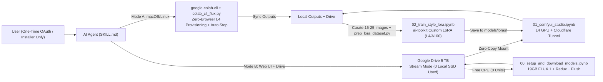

> **English** | [简体中文](./README.zh-CN.md)

# Google One AI Kit

> **All-in-one Google AI Pro / Google One automation skill — connect your 200 monthly Colab Compute Units, 5 TB Google Drive, and developer credits into a zero-friction CLI + ComfyUI + FLUX LoRA studio.**

---

## Why This Skill?

Most subscribers to **Google One / Google AI Pro (\$19.99/month)** only use the Gemini web chat and leave the rest of their monthly perks unused: **200 Colab Compute Units**, **5 TB of Google Drive**, **\$10/month in Google Cloud / Gemini API credits**, **1,000 Google Flow video credits**, and **Whisk**.

`google-one-ai-kit` packages the entire end-to-end production workflow into a reproducible **Agent Skill + CLI Automation Scripts + Colab Notebooks + ComfyUI Workflows**:

- **Dual Execution Modes**:
  - **Mode A · Pure CLI Automation (Recommended on macOS / Linux)**: Powered by [`google-colab-cli`](https://github.com/googlecolab/google-colab-cli). Perform **one-time OAuth once** (cached in OS Keyring), then spin up L4 GPUs, run multi-reference Redux blending via ComfyUI API, pull images locally, and run `colab stop` automatically in `finally:` — zero browser tabs and zero repeated OAuth prompts.
  - **Mode B · Interactive Web ComfyUI + Streamed Drive (All Platforms)**: Guides Google Drive Desktop installation in **Stream files** mode (0 local SSD consumed by 19 GB models) and launches a Cloudflare-tunneled ComfyUI UI when you want visual node tweaking.
- **Battle-Tested Hardening**: Includes free CPU model caching (0 compute units burned), `drive.flush_and_unmount()` to prevent 16 GB FUSE uploads from vanishing, direct Drive File ID -> Colab URL extraction, `--timeout 0` keepalive for long diffusion runs, and `colab stop` cost guards.

---

## Architecture Overview



---

## Install as an Agent Skill

Clone this repository into your agent's global or project skills folder, then ask your agent: *"Set up my Google AI Pro cloud image & LoRA studio using google-one-ai-kit"*:

```bash
# Antigravity (global skill)
git clone https://github.com/zhaoyibo2014/google-one-ai-kit.git ~/.gemini/config/skills/google-one-ai-kit

# Or project-local (Antigravity / Claude Code / Codex)
git clone https://github.com/zhaoyibo2014/google-one-ai-kit.git .agents/skills/google-one-ai-kit
```

---

## Quickstart

### Mode A: Pure CLI Automation (macOS / Linux Recommended)

Authenticate once into your OS Keyring, then run L4 GPU ComfyUI generations directly from your terminal with automatic VM shutdown:

```bash
git clone https://github.com/zhaoyibo2014/google-one-ai-kit.git
cd google-one-ai-kit

# 1. Local venv for helper scripts
python3 -m venv .venv
.venv/bin/pip install -r requirements.txt

# 2. Install google-colab-cli (requires Python >= 3.12; uv isolates 3.12 cleanly)
brew install uv   # or: pip install uv
uv tool install --python 3.12 google-colab-cli

# 3. One-time OAuth login (stored in OS Keyring) & check compute unit balance
~/.local/bin/colab usage

# 4. Run FLUX + single/multi-Redux on L4 GPU & auto-stop VM when finished
.venv/bin/python scripts/colab_cli_flux.py \
  --gpu L4 \
  --ref workspace/style_refs/ref_style_01.png:0.42 \
  --prompt "mystyle, stylized concept art of a futuristic explorer, clean dark background" \
  --count 2
```

### Mode B: Interactive Web ComfyUI + Google Drive Desktop

```bash
# 1. Check local environment & auto-download Google Drive Desktop installer
.venv/bin/python scripts/check_env.py
.venv/bin/python scripts/install_google_drive.py
# -> During Drive setup: click "Skip" on local folder backup & keep "Stream files" mode!

# 2. Sync notebooks, workflows & reference images, then extract direct Colab URLs
.venv/bin/python scripts/sync_to_drive.py
.venv/bin/python scripts/get_colab_urls.py
```

1. Open `00_setup_and_download_models.ipynb` on **CPU** runtime (`0` compute units) and **Run all** to cache the ~19 GB FLUX models into Drive (`Cell 5` flushes and unmounts safely).
2. Open `01_comfyui_studio.ipynb` on **L4 GPU**, **Run all**, and open the printed `https://*.trycloudflare.com` URL. Load `02_flux_redux_style.json` (`StyleModelApply.strength = 0.35~0.50`) to lock your style.
3. **Always click `Runtime -> Disconnect and delete runtime` when finished** to stop compute unit billing.

### Training Your Own Style LoRA (15–25 Curated Images)

```bash
# Resize to multiples of 16 (max 1024px), generate starter captions, and sync to Drive
.venv/bin/python scripts/prep_lora_dataset.py --input workspace/raw_selected --sync-to-drive
```

Accept the model license on [`black-forest-labs/FLUX.1-dev`](https://huggingface.co/black-forest-labs/FLUX.1-dev), add a Read `HF_TOKEN` to Colab **Secrets** (enable Notebook access), and run `02_train_style_lora.ipynb` on **L4** or **A100**. The final `.safetensors` LoRA is automatically saved to `models/loras/`.

---

## Repository Layout

| Path | Description |
| :--- | :--- |
| [`SKILL.md`](./SKILL.md) | Standard Agent Skill instructions (CLI Automation + Web ComfyUI + OAuth gates) |
| [`notebooks/`](./notebooks) | `00` Free CPU model cache, `01` ComfyUI Studio, `02` `ai-toolkit` LoRA trainer |
| [`workflows/`](./workflows) | Ready-to-use `01_flux_base_lora.json` and `02_flux_redux_style.json` |
| [`scripts/`](./scripts) | `colab_cli_flux.py`, `install_google_drive.py`, `get_colab_urls.py`, `check_env.py`, `sync_to_drive.py`, `prep_lora_dataset.py` |
| [`prompts/`](./prompts) | Natural-language FLUX prompt templates & LoRA dataset checklist |
| [`references/google-ai-pro-perks.md`](./references/google-ai-pro-perks.md) | Full guide to maximizing Google AI Pro perks (\$10 API credits, Flow, Whisk, Jules, NotebookLM) |
| [`references/troubleshooting.md`](./references/troubleshooting.md) | Solutions for Drive FUSE flush, OAuth errors, SSL certs, and CLI timeouts |

---

## License & Disclaimer

- Code, scripts, workflows, and notebooks in this repository are released under the [MIT License](./LICENSE).
- Third-party model weights remain governed by their respective licenses (`FLUX.1-dev` weights are non-commercial; use Apache-2.0 base models or obtain commercial licensing before commercial deployment).
