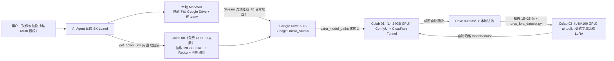

# Google One AI Kit

> **Google AI 会员全家桶自动化串联 Skill —— 打通 Google One AI Pro 的 Colab 算力、5 TB 云盘与开发者额度，榨干每一项会员权益；用户只做授权，其余下载、部署、ComfyUI 出图与 LoRA 训练全由 AI 自动接管。**

---

## 为什么做这个 Skill？

开通 **Google One / Google AI Pro（\$19.99/月）** 后，大多数人只用到了 Gemini 聊天，却白白浪费了每个月附带的 **200 个 Colab 计算单元**、**5 TB 云端硬盘**、**\$10/月 Google Cloud/Gemini API 开发者额度**、**1,000 点 Flow 视频额度** 与 **Whisk**。

`google-one-ai-kit` 把这套全流程封装成了可一键复刻的标准 **Agent Skill + 本地脚本 + Colab Notebook + ComfyUI 工作流**：
- **极简交互体验**：需要你动手的只有「安装弹窗拖一下 / 登录点授权」，软件下载、环境搭建、云盘目录初始化、Colab 切卡启动、ComfyUI 冒烟测试、收工断连防扣费全由 AI Agent 自动接管。
- **不占本地固态硬盘**：引导启用 Google Drive **Stream（流式传输）** 模式，19 GB FLUX 模型全存云端，Mac/PC 轻薄本也能秒级拉起 L4 GPU 出图与训 LoRA。
- **全避坑工程化**：内置免费 CPU 拉模（0 扣点）、`drive.flush_and_unmount()` 强制刷盘防大模型丢失、Drive File ID 直取 Colab URL、ComfyUI 就绪轮询等实战踩坑方案。

---

## 整体工作流架构



---

## 作为 Agent Skill 安装使用

将本仓库克隆到你的 Agent 全局或项目 Skill 目录，直接对 AI 说：**「按 google-one-ai-kit 帮我搭一套 Google AI Pro 云端生图和训练环境」** 即可：

```bash
# 1. Antigravity（全局 Skill）
git clone https://github.com/zhaoyibo2014/google-one-ai-kit.git ~/.gemini/config/skills/google-one-ai-kit

# 2. 或放入当前项目工作区（Antigravity / Claude Code / Codex 通用）
git clone https://github.com/zhaoyibo2014/google-one-ai-kit.git .agents/skills/google-one-ai-kit
```

---

## 手动快速上手（5 步跑通）

### 1. 初始化本地工具与自动下载 Google Drive 桌面版
```bash
git clone https://github.com/zhaoyibo2014/google-one-ai-kit.git
cd google-one-ai-kit

python3 -m venv .venv
.venv/bin/pip install -r requirements.txt

# 检查环境；如未安装 Google Drive 桌面版会自动下载官方安装包并提示配置步骤
.venv/bin/python scripts/check_env.py
.venv/bin/python scripts/install_google_drive.py
```
> 安装登录 Google Drive 桌面版时，**务必在「Sync with Google Drive」步骤点 `Skip` 跳过本地目录备份**，保持默认 **`Stream files` 流式模式**。

### 2. 同步工作流并获取 Colab 直达链接
```bash
# 可选：把你的风格参考图放入 workspace/style_refs/ 后同步
.venv/bin/python scripts/sync_to_drive.py

# 读取 Google Drive File ID 生成 Colab 直达 URL（绕开搜索延迟）
.venv/bin/python scripts/get_colab_urls.py
```

### 3. 免费 CPU 拉取底模（0 计算单元）
打开 `00_setup_and_download_models.ipynb` 直达链接，确认 **`Runtime -> Change runtime type -> CPU`**，点击 **`Run all`**。脚本会自动把约 19 GB 模型下进 Drive，并在第 5 步执行 `drive.flush_and_unmount()` 确保彻底落盘。

### 4. L4 GPU 启动 ComfyUI 锁画风出图
打开 `01_comfyui_studio.ipynb`，切到 **`L4 GPU`** 点击 **`Run all`**，打开输出的 `https://*.trycloudflare.com` 链接：
- **Phase 1（无需训练直接锁风格）**：加载 `02_flux_redux_style.json`，在 `LoadImage` 选参考图，`StyleModelApply.strength` 设为 **`0.35 ~ 0.50`**，改写 `CLIPTextEncode` 英文提示词即可生成同画风新主体。
- **收工防扣费**：用完务必点 **`Runtime -> Disconnect and delete runtime`**！

### 5. 攒齐 15~25 张图后训练专属风格 LoRA
```bash
# 整理训练集（缩放至 16 倍数对齐，自动生成触发词 .txt 标注且不覆盖已有手工标注）
.venv/bin/python scripts/prep_lora_dataset.py --input workspace/raw_selected --sync-to-drive
```
在 Colab 打开 `02_train_style_lora.ipynb`，配好 Hugging Face `HF_TOKEN`（需先在 `black-forest-labs/FLUX.1-dev` 同意协议），切换 `L4` 或 `A100` 一键开训，成品会自动归档至 `models/loras/`。

---

## 目录说明

| 路径 | 作用 |
| :--- | :--- |
| [`SKILL.md`](./SKILL.md) | 标准 Agent Skill 指令集（定义 Agent 全自动编排与授权暂停点） |
| [`notebooks/`](./notebooks) | `00` 免费 CPU 拉模、`01` ComfyUI 工作台、`02` `ai-toolkit` LoRA 训练 |
| [`workflows/`](./workflows) | `01_flux_base_lora.json` 与 `02_flux_redux_style.json` 开箱工作流 |
| [`scripts/`](./scripts) | 跨平台 Drive 安装引导、环境体检、File ID 直取、同步与数据集处理 |
| [`prompts/`](./prompts) | FLUX 自然语言提示词模板与 LoRA 凑料清单 |
| [`references/google-ai-pro-perks.md`](./references/google-ai-pro-perks.md) | **Google AI Pro 全家桶权益榨干攻略**（\$10 API 额度、Flow、Whisk、Jules、NotebookLM） |
| [`references/troubleshooting.md`](./references/troubleshooting.md) | Drive 刷盘、OAuth 授权、SSL 证书与 Colab 常见报错排查 |

---

## Google One AI Pro 配套权益速览

想了解如何把剩下的 **\$10/月云开发者额度**（可跑 150~300 张生图 API）、**Flow 1,000 点**、**Whisk**、**Antigravity / Jules** 一起用起来，请直接查看 👉 [**Google AI Pro 全家桶权益最大化指南**](./references/google-ai-pro-perks.md)。

---

## License & Disclaimer

- 本仓库代码、脚本与 Notebook 采用 [MIT License](./LICENSE) 开源。
- 第三方模型权重受各自协议约束（`FLUX.1-dev` 为非商用开源权重，如需商业化微调与分发请选用 Apache-2.0 模型或获取官方商业授权）。
