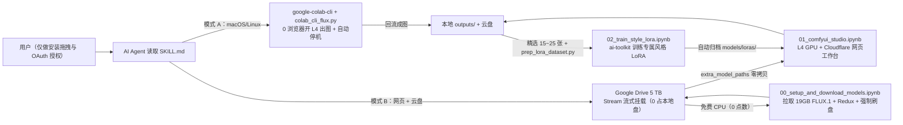

> [English](./README.md) | **简体中文**

# Google One AI Kit

> **Google AI 会员全家桶自动化串联 Skill —— 打通 Google One AI Pro 的 Colab 算力、5 TB 云盘与开发者额度，榨干每一项会员权益；用户只做授权，其余下载、部署、ComfyUI 出图与 LoRA 训练全由 AI 自动接管。**

---

## 为什么做这个 Skill？

开通 **Google One / Google AI Pro（\$19.99/月）** 后，大多数人只用到了 Gemini 聊天，却白白浪费了每个月附带的 **200 个 Colab 计算单元**、**5 TB 云端硬盘**、**\$10/月 Google Cloud/Gemini API 开发者额度**、**1,000 点 Flow 视频额度** 与 **Whisk**。

`google-one-ai-kit` 把这套全流程封装成了可一键复刻的标准 **Agent Skill + 纯命令行全自动脚本 + Colab Notebook + ComfyUI 工作流**：
- **双模式全自动接管**：
  - **模式 A · 纯命令行全自动模式（macOS / Linux 首选）**：集成官方 [`google-colab-cli`](https://github.com/googlecolab/google-colab-cli)，**只需首次做 1 次 OAuth 登录存进系统钥匙串**，之后开 L4、跑 ComfyUI API 多图融合或 **无头 2D 转 3D PBR 建模（`TRELLIS.2-4B` & `Hunyuan3D-2mv`）**、拉回成品、1 秒 `colab stop` 停机全在终端静默完成（0 浏览器窗口、0 每次重复弹窗）。
  - **模式 B · 网页交互 + 云盘流式模式（全平台通用）**：引导启用 Google Drive **Stream（流式传输）**，19 GB FLUX 模型全存云端不占本地 SSD，需要手调 ComfyUI 节点时一键拉起 Cloudflare 网页界面。
- **全避坑工程化**：内置免费 CPU 拉模（0 扣点）、`drive.flush_and_unmount()` 强制刷盘防大模型丢失、Drive File ID 直取 Colab URL、`--timeout 0` 长任务保活、3D 隔离 `micromamba`（Python 3.11 + CUDA 12.4.1）构建与 `finally` 自动关机止损等实战踩坑方案。

---

## 整体工作流架构



---

## 作为 Agent Skill 安装使用

将本仓库克隆到你的 Agent 全局或项目 Skill 目录，直接对 AI 说：**「按 google-one-ai-kit 帮我搭一套 Google AI Pro 云端生图和训练环境」** 即可：

```bash
# 1. Antigravity（全局 Skill）
git clone https://github.com/zhaoyibo2014/google-one-ai-kit.git ~/.gemini/config/skills/google-one-ai-kit

# 2. 或放入当前项目工作区（Antigravity / Claude Code / Codex 通用）
git clone https://github.com/zhaoyibo2014/google-one-ai-kit.git .agents/skills/google-one-ai-kit
```

---

## 快速上手

### 模式 A：纯命令行全自动出图（macOS / Linux 推荐）

一次登录存进系统钥匙串，之后零浏览器弹窗、全自动开卡出图并自动关机：
```bash
git clone https://github.com/zhaoyibo2014/google-one-ai-kit.git
cd google-one-ai-kit

python3 -m venv .venv
.venv/bin/pip install -r requirements.txt

# 1. 安装 uv 与 google-colab-cli（需 Python >= 3.12，uv 会自动隔离安装，不碰现有 3.11 虚拟环境）
brew install uv   # 或 pip install uv
uv tool install --python 3.12 google-colab-cli

# 2. 首次一次性 OAuth 登录（刷新令牌自动存系统钥匙串）并查看 200 计算单元余额
~/.local/bin/colab usage

# 3. 纯命令行开 L4 跑 FLUX（支持重复传入 --ref 实现多图风格融合，用完自动 colab stop）
.venv/bin/python scripts/colab_cli_flux.py \
  --gpu L4 \
  --ref workspace/style_refs/ref_style_01.png:0.42 \
  --prompt "mystyle, stylized concept art of a futuristic explorer, clean dark background" \
  --count 2

# 4. 或纯命令行开 L4 跑 2D 转 3D（微软 TRELLIS.2-4B PBR GLB 或腾讯 Hunyuan3D-2mv）
HF_TOKEN="hf_..." .venv/bin/python -u scripts/colab_cli_3d.py \
  --engine trellis2 \
  --input path/to/front_apose.png \
  --name hero_v1 \
  --gpu L4
```

### 模式 B：网页 ComfyUI + Google Drive 桌面版

```bash
# 1. 检查环境；如未安装 Google Drive 桌面版会自动下载官方安装包并提示配置步骤
.venv/bin/python scripts/check_env.py
.venv/bin/python scripts/install_google_drive.py
# -> 安装登录时务必点 Skip 跳过本地目录备份，保持 Stream files 流式模式！

# 2. 同步工作流并提取 Colab 直达链接（绕开搜索延迟）
.venv/bin/python scripts/sync_to_drive.py
.venv/bin/python scripts/get_colab_urls.py
```

1. 打开 `00_setup_and_download_models.ipynb`（确认 **CPU** 运行时，0 扣点）点 **Run all** 拉取 19 GB 底模并强制刷盘落库。
2. 打开 `01_comfyui_studio.ipynb` 切 **L4 GPU** 点 **Run all**，打开输出的 `https://*.trycloudflare.com` 网页即可使用 `02_flux_redux_style.json`（`strength = 0.35~0.50`）锁风格出图。
3. **收工必做**：点 **`Runtime -> Disconnect and delete runtime`** 防止闲置扣费！

### 攒齐 15~25 张图后训练专属风格 LoRA
```bash
.venv/bin/python scripts/prep_lora_dataset.py --input workspace/raw_selected --sync-to-drive
```
在 [`black-forest-labs/FLUX.1-dev`](https://huggingface.co/black-forest-labs/FLUX.1-dev) 同意协议并在 Colab 左侧 **Secrets** 填入 Read `HF_TOKEN`，运行 `02_train_style_lora.ipynb`（L4 或 A100）即可自动训完并归档至 `models/loras/`。

---

## 目录说明

| 路径 | 作用 |
| :--- | :--- |
| [`SKILL.md`](./SKILL.md) | 标准 Agent Skill 指令集（涵盖模式 A 纯 CLI 与模式 B 网页工作流） |
| [`notebooks/`](./notebooks) | `00` 免费 CPU 拉模、`01` ComfyUI 工作台、`02` `ai-toolkit` LoRA 训练 |
| [`workflows/`](./workflows) | `01_flux_base_lora.json` 与 `02_flux_redux_style.json` 开箱工作流 |
| [`scripts/`](./scripts) | 纯 CLI 出图（`colab_cli_flux.py`）、纯 CLI 转 3D（`colab_cli_3d.py`）、Drive 安装引导、体检、File ID 直取、同步与数据集处理 |
| [`prompts/`](./prompts) | FLUX 自然语言提示词模板与 LoRA 凑料清单 |
| [`references/image-to-3d-colab.md`](./references/image-to-3d-colab.md) | **Colab L4 无头 2D 转 3D（`TRELLIS.2` & `Hunyuan3D-2mv`）全流程与 10 个实战踩坑** |
| [`references/google-ai-pro-perks.md`](./references/google-ai-pro-perks.md) | **Google AI Pro 全家桶权益榨干攻略**（\$10 API 额度、Flow、Whisk、Jules、NotebookLM） |
| [`references/troubleshooting.md`](./references/troubleshooting.md) | Drive 刷盘、OAuth 授权、SSL 证书、CLI 超时与 3D 扩展编译排查 |

---

## License & Disclaimer

- 本仓库代码、脚本与 Notebook 采用 [MIT License](./LICENSE) 开源。
- 第三方模型权重受各自协议约束（`FLUX.1-dev` 为非商用开源权重，如需商业化微调与分发请选用 Apache-2.0 模型或获取官方商业授权）。
